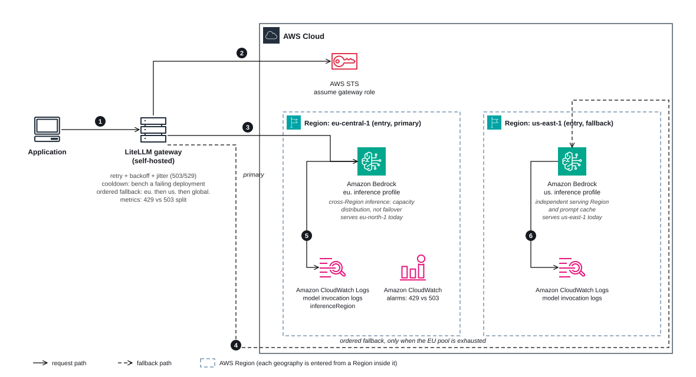

# Handle Amazon Bedrock 529 and 503 errors with LiteLLM routing and fallback



LiteLLM fails over at two levels:

1. **Same-model failover (load balancing):** deployments that share one `model_name` form a pool. On a retryable error, LiteLLM cools down the failed deployment and retries another deployment of the **same** model, typically in a different Region or cross-Region inference profile.
2. **Cross-model failover (fallbacks):** when the whole pool is exhausted, `fallbacks` routes the request to a **different** model group, for example from an Opus pool to a Sonnet pool.

A key finding behind these templates: Bedrock cross-Region inference (CRIS) is a capacity feature, not a failover mechanism. A geo inference profile (`us.`, `eu.`, `au.`, `jp.`) can serve every request from one Region, whatever entry Region you call. Two pool entries on the same geo profile therefore give you entry-endpoint redundancy, not serving-Region redundancy. Real independence needs different geo profiles or the `global.` profile, which means you must organise pools per data-residency boundary.

| Template | Proxy (`proxy/`) | SDK (`sdk/`) |
|----------|------------------|--------------|
| Same-model, cross-Region failover | `litellm-config-same-model-failover.yaml` | `same_model_failover.py` |
| Cross-model failover (Opus to Sonnet) plus context-window fallbacks | `litellm-config-cross-model-failover.yaml` | `cross_model_failover.py` |
| Cross-model failover with served-model observability | `litellm-config-cross-model-failover-observability.yaml` | `cross_model_failover_observability.py` |
| High reliability, soft EU-first (EU preferred, `global.` overflow) | | `high-reliability-soft-eu.py` |
| High reliability, hard EU-first (EU-only primary, ordered per-geo fallback chain) | | `high-reliability-hard-eu.py` |

See the [blueprint README](Litellm/LiteLLM-routing-fallback-529-503/README.md) for the proxy-to-SDK settings mapping, served-model detection, and guidance on `aws_region_name` versus `aws_bedrock_runtime_endpoint` versus `api_base`.

## Prerequisites

- An AWS account with [access to the Amazon Bedrock models](https://docs.aws.amazon.com/bedrock/latest/userguide/model-access.html) you plan to use, in every Region your pools reference.
- An IAM role your gateway can assume, with `bedrock:InvokeModel` and `bedrock:InvokeModelWithResponseStream` on the relevant models and inference profiles. The samples use STS assume-role (`aws_role_name`) and never static access keys.
- Python 3.10 or later for the SDK samples, or Docker/Kubernetes for the LiteLLM proxy.
- The AWS CLI configured with credentials for the target account.

## Getting started

1. Clone the repository and pick a blueprint from the table above.
2. Replace the placeholders. Samples use `111111111111` as the account ID and generic role names. Confirm the exact model and inference profile IDs on the Bedrock console model card for your account and Region.
3. Run a sample. For the LiteLLM SDK templates:

   ```bash
   pip install litellm
   python Litellm/LiteLLM-routing-fallback-529-503/sdk/same_model_failover.py
   ```

   For a proxy template:

   ```bash
   pip install 'litellm[proxy]'
   litellm --config Litellm/LiteLLM-routing-fallback-529-503/proxy/litellm-config-same-model-failover.yaml
   ```

4. Each blueprint README lists its specific prerequisites, configuration and verification steps.

## Security considerations

- **Authentication:** do not expose a gateway endpoint without authentication. Set a LiteLLM `master_key` from AWS Secrets Manager and issue scoped virtual keys to clients. Use inbound authorization (for example Amazon Cognito or another OAuth provider) for AgentCore Gateway.
- **Network exposure:** keep the gateway on private subnets behind an authenticated load balancer. Use [AWS PrivateLink for Amazon Bedrock](https://docs.aws.amazon.com/bedrock/latest/userguide/vpc-interface-endpoints.html) (`aws_bedrock_runtime_endpoint`) when traffic must not cross the public internet.
- **Least privilege:** scope the invoke role to the specific foundation models and inference profiles each pool uses.
- **Data residency:** cross-geo and `global.` inference profiles can process requests outside your primary geography. Only add them to a pool when that is acceptable for the data involved.
- **Secrets:** never commit credentials, API keys or master keys. Use environment variables sourced from Secrets Manager or Parameter Store.
- **Shared state:** in production, configure Redis so cooldown and fallback state is shared across gateway replicas.


