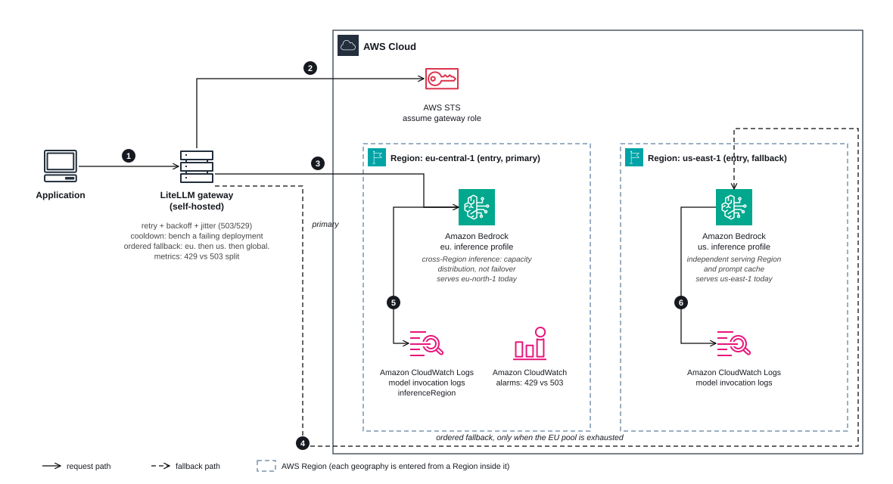
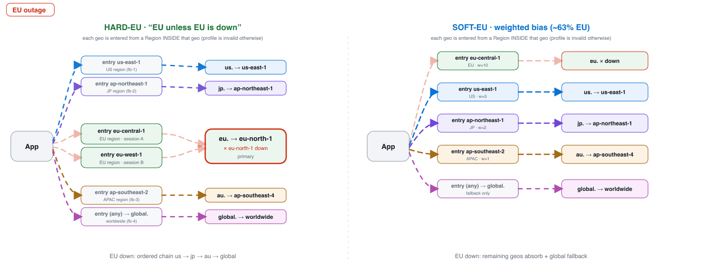

# LiteLLM routing and fallback for Anthropic 529/503 errors on Amazon Bedrock

When an Anthropic model on Amazon Bedrock runs short of serving capacity, requests fail with `529 overloaded_error` or `503 ServiceUnavailableException`. Retries alone rarely recover, because each retry on the same inference profile usually lands on the same constrained Region.

This sample shows how to keep a LiteLLM gateway serving through that kind of event. It contains:

- A LiteLLM routing and fallback configuration for Claude Opus 5.5 and Claude Opus 5 (`proxy/litellm-config.yaml`).
- Tests that show how LiteLLM 1.109.1 classifies Bedrock 529 and 503 errors, and how it retries and falls back.
- Scripts that measure which Region serves each request, how long long generations take, and how prompt caches behave across Regions.



The application calls a self-hosted LiteLLM gateway. The gateway assumes an IAM role and calls Amazon Bedrock. The primary route is the EU profile for Claude Opus 5.5. The global profile for the same model is used only when the EU route is exhausted. Claude Opus 5 is the model fallback, used only when Claude Opus 5.5 fails on every route. Each entry Region writes model invocation logs, including the serving Region, to Amazon CloudWatch Logs.

## Classify the error first

Three Bedrock errors look alike on a dashboard and need different responses.

| Error | What it means | What to do |
|---|---|---|
| `429 ThrottlingException` | You exceeded your account quota for requests or tokens per minute. | Shape requests, or request a quota increase. |
| `503 ServiceUnavailableException` | Bedrock temporarily can't serve the request. It isn't tied to your quota. | Retry with backoff, and have another Region to send traffic to. |
| `529 overloaded_error` | The model can't process the request because of high demand or insufficient serving capacity. | Retry with backoff, honor any `Retry-After` header, and route away from the constrained capacity. |

More quota doesn't fix a capacity problem on the service side. Patient retries and another place to send the request do. For the full definitions, see [Troubleshooting Amazon Bedrock API error codes](https://docs.aws.amazon.com/bedrock/latest/userguide/troubleshooting-api-error-codes.html).

An Anthropic overload can arrive as an HTTP `529` or as a `503` whose message says the model is overloaded. Treat both as the same capacity signal. LiteLLM 1.109.1 maps them differently:

| Bedrock status | LiteLLM exception | Retry count used |
|---|---|---|
| 429 | `RateLimitError` | `retry_policy.RateLimitErrorRetries` |
| 503 | `ServiceUnavailableError` | `retry_policy.ServiceUnavailableErrorRetries` |
| 529 | `APIError` (status 529) | `num_retries`, because `RetryPolicy` has no `APIError` entry |

## Choose routing, fallback, or both

- **Routing** keeps the same model and sends the request to a different serving Region. Use it when your application must stay on one model, for example because downstream parsing depends on it.
- **Fallback** switches to a different model. Use it when your prompts work on a second model and availability matters more than consistent output.

| Your workload | Use |
|---|---|
| Must stay on one model, with large, stable prompts | Routing, with a hard primary Region |
| Must stay on one model, with small or varied prompts | Routing, hard primary Region or weighted |
| Can accept a second model | Routing, then fallback |
| Availability first, any capable model | Fallback, optionally with routing |

Routing only helps if the second target really runs in a different Region. Cross-Region inference profiles draw on capacity across several Regions, but they don't move a failing request to a healthy Region for you. Measure where each profile serves from before you rely on it. The scripts in `sdk/` do this.

## What the measurements showed

These results come from one AWS account, with entry Regions us-east-1, eu-west-1 and eu-north-1, in November 2026. Placement can differ by account and change over time, so run the scripts against your own account before you rely on any of these numbers.

**Placement for Claude Opus 5.5 stayed fixed for 24 hours.** Five requests per target every 15 minutes, 480 requests per target:

| Profile | Called from | Served from | Region changes in 24 hours |
|---|---|---|---|
| `eu.anthropic.claude-opus-5-5` | eu-west-1 | eu-north-1: 100% | 0 |
| `eu.anthropic.claude-opus-5-5` | eu-north-1 | eu-north-1: 100% | 0 |
| `global.anthropic.claude-opus-5-5` | eu-north-1 | ap-southeast-4: 100% | 0 |

The entry Region didn't change the serving Region. Two gateway entries on the same profile protect against an entry-side problem, but not against the serving Region running short of capacity. The global profile served from another continent, so routing from the EU profile to the global profile added real Regional diversity in this account.

**Placement depends on the model.** 30 requests per model on US profiles from us-east-1. The pattern was the same on two separate days.

| Model (US profile) | Served from |
|---|---|
| Claude Opus 5.5 | us-east-1: 100% |
| Claude Haiku 4.5 | us-west-2: 100% |
| Llama 3.3 70B | us-east-2: 100% |
| Claude Sonnet 4.5 | us-east-2: 97%, us-west-2: 3% |
| Amazon Nova Micro | us-west-2: 87%, us-east-1: 10%, us-east-2: 3% |
| Amazon Nova Lite | us-west-2: 70%, us-east-2: 20%, us-east-1: 10% |

**Long generations exceed 60 seconds.** Claude Opus 5.5 produced 4,096 output tokens in a median of 43 s (p99 46 s, 30 calls), about 95 output tokens per second. One 10,000-token call took 110 s.

**A timeout doesn't stop the billed work.** With a 5-second timeout on a 3,000-token request, LiteLLM gave up after 5 s, but the invocation log shows Bedrock still generated all 3,000 tokens.

**Retries multiply load during an outage.** With the configuration in this sample and every call returning 529 (or 503), one request made 18 Bedrock attempts over about 50 to 60 s: six on each of the three aliases.

**Prompt caches are per Region.** A 5,543-token prefix cached in one serving Region was not reused from another. Each new Region paid a full cache write.

Caveats:

- The 529 and 503 tests use mocked Bedrock responses. We did not capture a real Bedrock overload response, so we can't confirm which status code Bedrock returns during an Anthropic overload.
- Latency was measured for non-streaming calls only.
- We did not observe any cache-aware placement. The results show only that caches are per Region.

## The configuration

`proxy/litellm-config.yaml` defines one alias per serving destination for Claude Opus 5.5, then Claude Opus 5 as the outer layer:

| Alias | Profile | Entry Region | Role |
|---|---|---|---|
| `claude-opus` | `eu.anthropic.claude-opus-5-5` | eu-west-1 and eu-north-1 | Primary. Two entries give entry-path redundancy on one serving Region. |
| `claude-opus-global` | `global.anthropic.claude-opus-5-5` | eu-north-1 | Routing: same model, a profile measured to serve from a different Region. |
| `claude-opus-5` | `eu.anthropic.claude-opus-5` | eu-west-1 | Fallback: a different model. |

```yaml
router_settings:
  num_retries: 5          # default count; a 529 (APIError) uses this
  allowed_fails: 2        # failures before a deployment is cooled down
  cooldown_time: 30       # seconds a failing deployment is skipped
  retry_policy:
    RateLimitErrorRetries: 3          # 429
    ServiceUnavailableErrorRetries: 5 # 503
    TimeoutErrorRetries: 2
  fallbacks:
    - claude-opus: ["claude-opus-global", "claude-opus-5"]
```

LiteLLM implements the same-model step through its `fallbacks` setting, because each destination is a separate alias. This README still calls that step routing, because the model doesn't change. Only the move to `claude-opus-5` is a model fallback.

Each deployment tags its requests with `requestMetadata` (for example `route: "eu-primary"`), so you can see in the invocation logs which route served a call.

Things to check before you use it:

- **Timeouts.** Each deployment sets `timeout: 300`. For non-streaming calls, the deployment `timeout` takes priority over router settings. Streaming calls read `stream_timeout` instead, so set both if you stream. At about 95 tokens per second, 300 s covers roughly 28,000 output tokens. Set your own value above your measured p99. A timeout shorter than your longest generations makes a capacity event worse: the client retries while Bedrock is still generating, the abandoned work is still billed, and each retry adds load to the constrained Region. The boto3 default read timeout of 60 s is too short for long generations if you call Bedrock directly. LiteLLM uses its own HTTP client, so the boto3 default doesn't apply to it.
- **Retries.** Keep per-alias retry counts as low as your success target allows, and use backoff with jitter so many workers don't retry in a synchronized burst.
- **The fallback model.** Confirm that your prompts, output format and context window hold on Claude Opus 5. In our test, Claude Opus 5 called from eu-west-1 was served from eu-north-1, the same Region as the primary. That helps when the constraint is on Claude Opus 5.5 itself, but adds no Regional diversity. If you need both, use a fallback profile you've measured to serve from a different Region.

For the full reference, see [LiteLLM routing](https://docs.litellm.ai/docs/routing) and [LiteLLM fallbacks](https://docs.litellm.ai/docs/proxy/reliability).

## Stay on one model without multiplying prompt cache costs

A common requirement is to keep every request on the same model, route it to another Region when capacity runs short, and still keep prompt caching cheap. These goals pull against each other. Prompt caching stores a reusable prompt prefix so it isn't reprocessed on every call, but the cache lives in the Region that served the request. The first request to each new serving Region pays the cache-write rate on the whole prefix. How you spread traffic across Regions therefore decides how many caches you pay to keep warm:

- A **hard primary-Region** shape sends normal traffic to one destination and moves only when it fails. You keep one warm cache and pay rebuild costs only during an event.
- A **weighted** shape spreads normal traffic across several destinations. You keep a warm cache in each one and pay to rebuild each as it expires, even when nothing is wrong.

Both shapes cover the same failure. For large, stable prompts, the hard shape avoids a standing cost. `proxy/litellm-config.yaml` is a hard shape.

The animations below use a four-geo example for Claude Opus 5.5. Each geo profile is entered from a Region inside that geo (a geo profile called from outside its geo is rejected), and both configs fall back to the `global.` profile last.

| Shape | Normal traffic | During an EU outage | Proxy config | SDK Router |
|---|---|---|---|---|
| Hard primary-Region | 100% EU | Ordered chain: US, then JP, then AU, then global | [`proxy/litellm-config-hard-eu.yaml`](./proxy/litellm-config-hard-eu.yaml) | [`sdk/litellm-router-hard-eu.py`](./sdk/litellm-router-hard-eu.py) |
| Weighted | About 63% EU, the rest spread across US, JP and AU (weights 10, 3, 2, 1) | US, JP and AU absorb the EU share; global if the whole pool fails | [`proxy/litellm-config-soft-eu.yaml`](./proxy/litellm-config-soft-eu.yaml) | [`sdk/litellm-router-soft-eu.py`](./sdk/litellm-router-soft-eu.py) |

Both configs send requests outside the EU, so use them only when your workload has no data-residency requirement. Neither includes a model fallback; to add one, append a different-model alias at the end of the `fallbacks` chain, as `proxy/litellm-config.yaml` does with Claude Opus 5.


*Normal operation. Left: [`litellm-config-hard-eu.yaml`](./proxy/litellm-config-hard-eu.yaml) ([SDK](./sdk/litellm-router-hard-eu.py)). Right: [`litellm-config-soft-eu.yaml`](./proxy/litellm-config-soft-eu.yaml) ([SDK](./sdk/litellm-router-soft-eu.py)).*

During an EU capacity event, the hard shape moves along its ordered chain, while the weighted shape loses its EU share and the other destinations absorb the traffic.



*EU outage, same two configs. In a mocked test on LiteLLM 1.109.1 with every EU call failing, the hard config served all requests from US (from JP when US also failed, and from global when every geo failed). The weighted config spread them across US, JP and AU, with a few reaching global.*

Expect a one-time spike in cache writes right after traffic moves. Track the cache-hit ratio so you can tell a re-warm apart from a gateway change that breaks the cacheable prefix. For pricing, see [Prompt caching for faster model inference](https://docs.aws.amazon.com/bedrock/latest/userguide/prompt-caching.html).

## Repository layout

```
proxy/
  litellm-config.yaml          # routing and fallback: EU -> global -> Claude Opus 5
  litellm-config-hard-eu.yaml  # hard primary-Region shape: EU, then US -> JP -> AU -> global
  litellm-config-soft-eu.yaml  # weighted shape: EU/US/JP/AU in one pool, then global
sdk/
  router_fallback_mock_test.py      # mocked 529/503: exception types and retry/fallback counts (no AWS calls)
  router_fallback_live_test.py      # live Router test: each alias, forced fallback, timeout, invocation-log check
  cris-routing-by-model.py          # serving Region per model, 30 calls each
  cris-pinning-over-time.py         # serving Region over time (24 h, 15-minute rounds)
  cris-pinning-20261108-2340.csv    # output of the 24-hour run summarized above
  litellm-sdk-cris-prompt-cache-test.py     # cache write/read across Regions
  opus-long-generation-latency.py           # time to last token on long generations
  opus-long-generation-latency-20261114-2225.csv  # output of the latency run summarized above
  enable_bedrock_invocation_logging.py      # enables invocation logging (needed by the log-based tests)
  litellm-router-hard-eu.py         # SDK Router version of proxy/litellm-config-hard-eu.yaml
  litellm-router-soft-eu.py         # SDK Router version of proxy/litellm-config-soft-eu.yaml
```

## Prerequisites

- Python 3.10 or later, with `pip install "litellm==1.109.1" boto3 aws-bedrock-token-generator pyyaml`. The tests were run on LiteLLM 1.109.1.
- An AWS account with access to Claude Opus 5.5 and Opus 5 in Amazon Bedrock. Confirm the inference profile IDs for your account with `aws bedrock list-inference-profiles --region <region>`.
- AWS credentials in your shell, for example from `aws login` or a named profile. The scripts never read static keys from the code.
- An IAM identity allowed to call `bedrock:InvokeModel` on the profiles you use. The log-based tests also need `logs:FilterLogEvents` on the log group, and `cloudtrail:LookupEvents` if you check CloudTrail.
- Model invocation logging enabled to CloudWatch Logs in each Region you call from. Run `sdk/enable_bedrock_invocation_logging.py` to set it up (see [Verify the serving Region](#verify-the-serving-region-for-each-request)).
- For the proxy config, an existing LiteLLM deployment with Amazon Bedrock access. The SDK scripts don't need one.

## Configuration

The three files in `proxy/` use the placeholder account `111111111111` in their `aws_role_name` values. The two SDK Router scripts (`litellm-router-*.py`) read `LITELLM_ROLE_ARN` instead. The hard and weighted configs also call the `us.`, `jp.` and `au.` profiles, so confirm those are available in your account. For the tests, do either of these:

- Set `LITELLM_ROLE_ARN` to a role your identity can assume. The live test uses it for every deployment.
- Leave it unset. The live test drops `aws_role_name` and uses your calling credentials.

To use the config in your own LiteLLM proxy, merge its `model_list` and `router_settings` into your proxy config, and replace the account in `aws_role_name` or remove those lines.

## Running the tests

Run these from the `sdk/` folder.

```bash
cd sdk
python router_fallback_mock_test.py   # no AWS calls; start here
```

| Script | Needs AWS | Time | What it shows |
|---|---|---|---|
| `router_fallback_mock_test.py` | No | About 2 min | Exception type for 529 and 503, and the number of attempts across the three aliases. |
| `router_fallback_live_test.py` | Yes | About 3 min | One request per alias, forced fallbacks, a 5-second timeout, and the invocation-log records. |
| `cris-routing-by-model.py` | Yes | About 5 min | Serving Region for six models, 30 calls each. |
| `cris-pinning-over-time.py --hours 24 --interval 15` | Yes | 24 h | Serving Region over time. Use `--hours 0.5 --interval 2` for a short check. Use `--report FILE.csv` to print a summary from a saved run. |
| `litellm-sdk-cris-prompt-cache-test.py` | Yes | About 5 min | Cache writes and reads for the same prefix across geographies. |
| `opus-long-generation-latency.py --n 30 --workers 5` | Yes | About 5 min | Time to last token and percentiles for 2,000+ token outputs. |

The log-based scripts read the serving Region from invocation logs. Logs appear about one minute after a call, and the scripts retry until they do.

Costs are small: each run makes at most a few hundred calls with short prompts. The latency test generates 4,096 tokens per call, so it costs the most.

## Verify the serving Region for each request

Bedrock doesn't return the serving Region in the API response. You read it from the `inferenceRegion` field in model invocation logs:

1. Create a CloudWatch Logs log group in each Region you call from.
2. Grant Bedrock permission to write to it.
3. Enable logging with the `PutModelInvocationLoggingConfiguration` API or on the Amazon Bedrock console.
4. Send a request with a unique `requestMetadata` tag.
5. Query the log group in your entry Region for that tag and read `inferenceRegion`.

`sdk/enable_bedrock_invocation_logging.py` does steps 1 to 3 for every enabled Region in the account. In each Region it creates the log group `/aws/bedrock/model-invocations`, an S3 bucket `bedrock-invocation-logs-<account>-<region>`, and an IAM role `BedrockInvocationLogging-<region>`. It is safe to re-run. For details, see [Monitor model invocation using CloudWatch Logs and Amazon S3](https://docs.aws.amazon.com/bedrock/latest/userguide/model-invocation-logging.html).

AWS CloudTrail also records the serving Region, in `additionalEventData.inferenceRegion`, but it doesn't carry your `requestMetadata` tags. Use invocation logs to trace a specific route.

To tell a quota problem from a capacity problem quickly, add CloudWatch alarms that separate `InvocationThrottles` (429) from `InvocationServerErrors` (5xx) by model and Region.

## Key facts about the APIs

- **`inferenceRegion` is the serving Region.** It appears in the Bedrock invocation log and in CloudTrail (`additionalEventData.inferenceRegion`). The top-level `region` and `awsRegion` fields hold the entry Region.
- **Invocation logs are written to the entry Region's log group only.** To find a call's serving Region, query the log group in the Region you called from.
- **`requestMetadata` is the tag field.** LiteLLM passes it to Bedrock, and it appears in the invocation log, not in CloudTrail management events.
- **Use the profile ID without a version suffix,** for example `eu.anthropic.claude-opus-5-5`. A `-v1:0` suffix returns `ResourceNotFoundException`.
- **A geo profile must be called from a Region in its geography.** Calling `eu.` from us-east-1 returns "The provided model identifier is invalid."

## Cleanup

To avoid ongoing charges, remove what you created for testing:

1. Delete the invocation logging configuration in each Region with `DeleteModelInvocationLoggingConfiguration`.
2. Delete the `/aws/bedrock/model-invocations` log groups, the `bedrock-invocation-logs-<account>-<region>` S3 buckets, and the `BedrockInvocationLogging-<region>` IAM roles.
3. Delete the IAM role the gateway assumed, if you created one and no longer need it.

## Security

- The scripts use the AWS credentials in your environment. Don't commit keys, bearer tokens or `.env` files.
- The invocation logs contain prompts and responses. The setup script keeps them for 90 days by default. Change `LOG_RETENTION_DAYS` and `S3_EXPIRY_DAYS` to match your policy.
- The mock and latency scripts send only generic prompts. Don't reuse them with production data without reviewing where the logs go.
- The gateway should not be exposed without authentication. See the LiteLLM documentation on `master_key` and virtual keys.

## Notes

- The routing config sends requests to a `global.` profile, which can serve from any Bedrock Region. Check the data-residency rules for your workload before you use it.
- The fallback model, Claude Opus 5, is a different model from the primary. Confirm that your prompts and output format work on it before you rely on it.

## Further reading

- [Implementing resilience patterns with Amazon Bedrock and LLM gateway](https://aws.amazon.com/blogs/machine-learning/implementing-resilience-patterns-with-amazon-bedrock-and-llm-gateway/)
- [Increase throughput with cross-Region inference](https://docs.aws.amazon.com/bedrock/latest/userguide/cross-region-inference.html)
- [Reliability pillar of the Well-Architected Generative AI Lens](https://docs.aws.amazon.com/wellarchitected/latest/generative-ai-lens/reliability.html)
