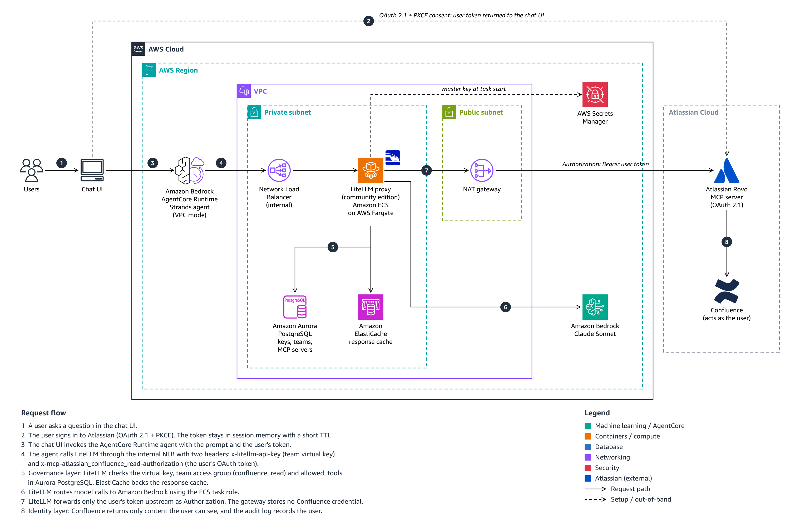

# LiteLLM MCP gateway: per-user Confluence access for AgentCore agents

This blueprint shows how to expose Confluence to Amazon Bedrock AgentCore agents through a self-hosted LiteLLM MCP gateway, with two independent authorization layers:

| Layer | Direction | Credential | Decides |
|---|---|---|---|
| Governance | Agent to gateway | LiteLLM virtual key (team access group) | Which MCP servers and tools the agent can list and call |
| Identity | Gateway to Confluence | User's own OAuth 2.1 token | Which content Confluence returns, and as whom |

An agent gets a result only when both checks pass. The gateway stores no Confluence credential, and the pattern runs on the LiteLLM community edition.

## Architecture



The gateway side is configured in [`proxy/config.yaml`](proxy/config.yaml) (or registered at runtime with [`scripts/register_mcp_server.sh`](scripts/register_mcp_server.sh)). The agent side, which sends the team virtual key and the user's token, is [`client/agent.py`](client/agent.py).

## Contents

```
litellm-mcp-gateway/
├── proxy/config.yaml               # Gateway config with a read-only Confluence MCP server
├── scripts/register_mcp_server.sh  # Register the server in the DB and create a team key
├── client/
│   ├── agent.py                    # Strands agent that sends both headers
│   └── requirements.txt
└── images/
    └── litellm-mcp-gateway-architecture.png
```

## Prerequisites

- LiteLLM proxy (community edition) on Amazon ECS with AWS Fargate, backed by Aurora PostgreSQL, with `store_model_in_db: true`
- A private entry point for agents, such as an internal Network Load Balancer. No public exposure
- Amazon Bedrock model access in the same Region
- `LITELLM_MASTER_KEY` in AWS Secrets Manager
- An Atlassian Cloud organization where an admin has enabled the Rovo MCP server, approved the OAuth app, and added your client origin under Rovo MCP server domain settings

## Deploy

1. Use `proxy/config.yaml` as the gateway config, or register the server at runtime:
   ```bash
   export LITELLM_PROXY_URL=https://litellm.internal.example.com
   export LITELLM_MASTER_KEY=sk-...
   ./scripts/register_mcp_server.sh
   ```
   Servers stored in the database are picked up without a restart. Changes to `config.yaml` need a new ECS deployment.
2. Confirm the tool names your tenant exposes, and adjust `allowed_tools` if needed:
   ```bash
   curl -sS "$LITELLM_PROXY_URL/mcp/" \
     -H "x-litellm-api-key: Bearer $LITELLM_VIRTUAL_KEY" \
     -H "x-mcp-atlassian_confluence_read-authorization: Bearer $USER_OAUTH_TOKEN" \
     -H "Content-Type: application/json" -H "Accept: application/json, text/event-stream" \
     -d '{"jsonrpc":"2.0","id":1,"method":"tools/list"}'
   ```
3. Run the sample agent:
   ```bash
   pip install -r client/requirements.txt
   export LITELLM_VIRTUAL_KEY=sk-... USER_OAUTH_TOKEN=...
   python client/agent.py
   ```

## Verify per-user attribution

In Atlassian Administration, open **Security > Audit log**. Each Confluence read should appear under the calling user, not a service account.

## Notes

- **Header names:** some proxies (nginx by default) drop headers that contain underscores. If yours does, use a hyphenated server name such as `confluence-read`.
- **Search:** the read-only allowlist covers browsing spaces and pages. To let agents search, add the Rovo CQL search tool to `allowed_tools` after confirming its name with `tools/list`.
- **Least privilege:** register the same upstream as several servers (for example `confluence_read` and `confluence_write`), each with its own `allowed_tools` and access group.
- **Token handling:** keep the user token in session memory with a short TTL. Do not persist it.

## Clean up

1. Remove the `confluence_read` access group from team keys.
2. Delete the MCP server from the gateway (Admin UI or API), or remove it from `config.yaml` and redeploy.
3. Delete any ECS, Aurora, ElastiCache and load balancer resources you created for testing.

## Cost

Amazon Bedrock charges per token. Amazon ECS, Aurora, ElastiCache and Elastic Load Balancing charge for the resources you run. Use the AWS Pricing Calculator for estimates.

## Security

See [CONTRIBUTING](../../CONTRIBUTING.md#security-issue-notifications).

## License

MIT-0. See [LICENSE](../../LICENSE).
